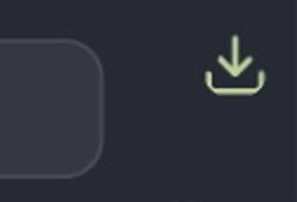
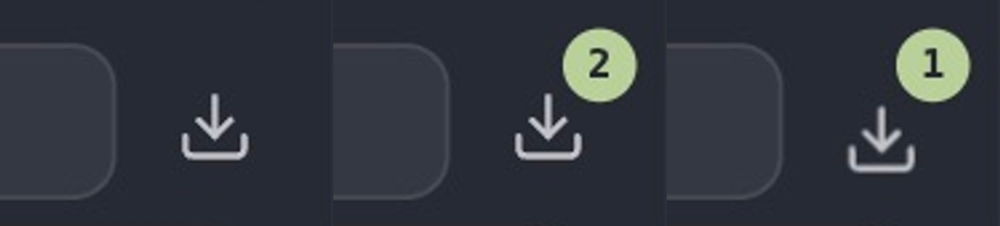

# fix(browser): keep downloads icon centered without a count badge

## Problem

With empty download history, the Downloads icon moves to the upper-right corner of its button and takes the count badge color instead of staying centered. The button looks clipped or misaligned. Opening the panel is not blocked; no file loss was established.

## Environment

Original failure: official CanvasTTY **1.8.5-beta2**, macOS 27.0 (26A428), arm64, isolated QA profile through `CANVASTTY_USER_DATA_DIR`, synthetic test data. Base: `df274cfb144b2d46bbc3ab6a3b2d92c12549169e`; original app.asar SHA256: `fef3047003ca7987e7062f23d700e6edf30fce75adee9476b27437815a2fd184`.

## Original problem: reproduction and evidence

1. Launch beta2 with an isolated profile and empty download history.
2. Open a Browser card.
3. Inspect Downloads to the right of the address field.

**Expected:** a centered icon with no numeric badge, consistent with navigation buttons using grid placement and a count rendered only when downloads exist.
**Observed:** the icon is shifted up/right and receives badge colors. The user reported it and the baseline QA copy shows it. No repeated-trial count was recorded.



This crop establishes the visible static placement and color defect. It does not claim a loading or animation failure.

## Cause and implemented change

UiIcon renders a span. The numeric count is another span rendered only when history is nonempty. The old `.browser-card__downloads > span:last-child` badge rule therefore targets the icon when no count is present, applying `position: absolute; right: -2px; top: -3px` and badge colors.

The count now has an explicit `browser-card__download-count` class, and the badge rule targets only that class. Count semantics, panel handling, active-download animation rules and reload are unchanged.

Baseline source: [button markup](https://github.com/howdeploy/CanvasTTY/blob/df274cfb144b2d46bbc3ab6a3b2d92c12549169e/src/renderer/src/features/browser/BrowserCard.tsx#L528), [UiIcon span](https://github.com/howdeploy/CanvasTTY/blob/df274cfb144b2d46bbc3ab6a3b2d92c12549169e/src/renderer/src/components/UiIcon.tsx#L164), [badge selector](https://github.com/howdeploy/CanvasTTY/blob/df274cfb144b2d46bbc3ab6a3b2d92c12549169e/src/renderer/src/styles/app.css#L776).

Branch: `fix/beta2-download-icon`. Fixed revision: `ccc47c01160c748d1a43ff8b95bd7fd73ce789c1`; direct parent: exact beta2 `df274cfb144b2d46bbc3ab6a3b2d92c12549169e`.

## Result after the fix: evidence

**GUI/static placement:** a separate official beta2 QA copy retained the original main/preload/Electron runtime and used the production renderer built from this fixed revision. It was signed locally with the updated ASAR integrity hash; integrity checks remained enabled. An isolated profile and loopback-only synthetic downloads were used; this was not a dev server.



From left to right: empty history has a centered icon and no badge; two completed downloads have a separate `2` badge; one active download has a separate `1` badge even though history contains three entries. The icon remains inside its button. This checks empty-state placement and nonempty badge separation under the same QA runtime/renderer setup; baseline and fixed crops come from separate isolated runs, not a continuous before/after recording.

The static montage does not prove motion or animation timing. No animation video was captured, and animation behavior is not part of the fixed defect. The panel also opened and showed three completed downloads in the manual control.

**Component/CSS boundary:** the three new tests failed on beta2's old selector/missing explicit count target, then passed after the fix. They cover rendered count markup and static CSS targeting, not pixels. Focused GREEN log excerpt:

```text
✔ empty downloads button keeps its icon out of the absolute count badge rule (23.333417ms)
✔ completed downloads retain a separate total count badge (7.60075ms)
✔ active downloads keep the active count and icon animation class separate from the badge (6.151667ms)
ℹ tests 9
ℹ pass 9
ℹ fail 0
ℹ skipped 0
```

Node/renderer typechecks and the production bundle passed. The full suite and full release packaging pipeline were not run.

## Verification limits

The selected test logs are reused from the stated unchanged commit; no new execution is claimed. The full suite has not been established green. There was no comparative Linux/Windows or earlier-release GUI run, so platform exclusivity and regression status are not claimed. Selected screenshots are versioned alongside this report; their captions distinguish the original problem from the fixed result.

The implementation and tests were verified at the fixed revision above. The subsequent documentation-only commit adds this report and selected evidence; it does not change executable code. Each fix is independent and targets `dev/1.8.5-beta2-optimization`, whose head was verified as exact beta2 before publication.
