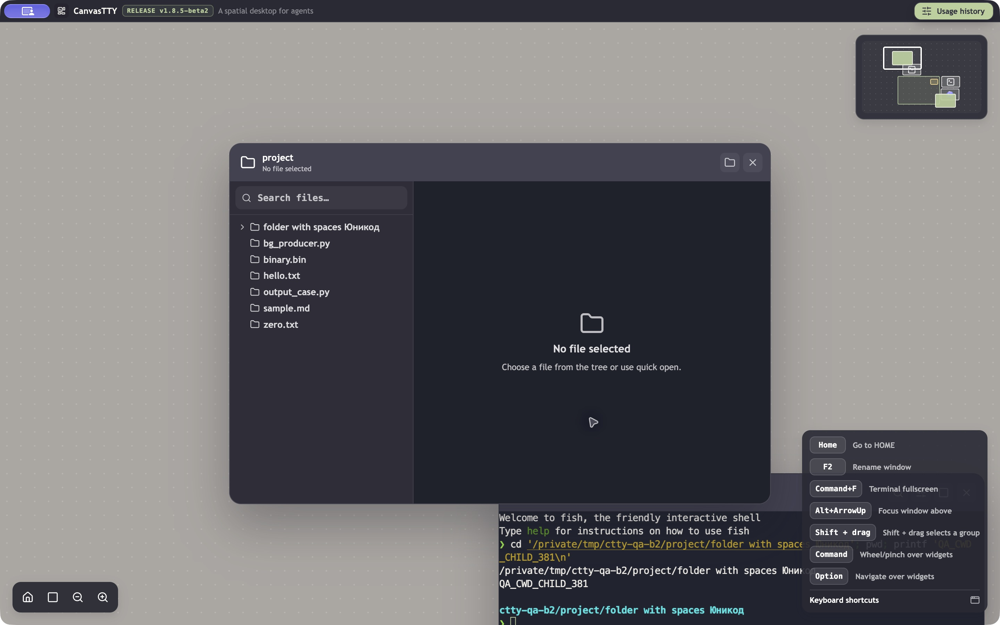
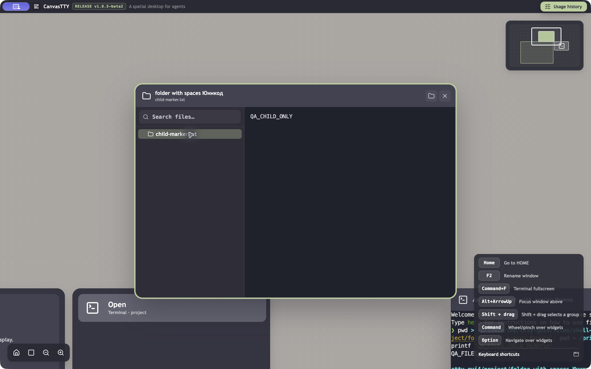

# fix(files): resolve live shell cwd when choosing a session

## Problem

Files > Session working directory opens a shell's launch directory after cd. Expected files from the current directory appear missing.

## Environment

Original failure: official CanvasTTY **1.8.5-beta2**, macOS 27.0 (26A428), arm64, isolated QA profile through `CANVASTTY_USER_DATA_DIR`, synthetic test data. Base: `df274cfb144b2d46bbc3ab6a3b2d92c12549169e`; original app.asar SHA256: `fef3047003ca7987e7062f23d700e6edf30fce75adee9476b27437815a2fd184`.

The baseline GUI used fish; its version was not recorded. The after-change PTY smoke used `/bin/zsh -f`.

## Original problem: reproduction and evidence

1. Start a shell in synthetic project containing hello.txt and a child directory named folder with spaces Юникод.
2. Run `cd 'folder with spaces Юникод'; pwd`.
3. Create Files and choose this session under Session working directory.

**Expected for this fix:** use the live local shell's current directory at selection time. The operator explicitly selected this behavior; the original UI contract did not resolve current versus launch directory unambiguously.
**Observed on beta2:** Files stays rooted at project and lists hello.txt and the child directory, while the shell reports the child path.

**Repeatability:** one controlled synthetic reproduction and an earlier observation; no complete trial count, so 2/2 is not claimed.



The image establishes the simultaneous mismatch between the Files root/list and the shell's displayed cwd. It does not establish the preceding selector interaction by itself; that sequence was recorded as the controlled observation. No sequence video is available.

## Cause and implemented change

The original route uses terminalManager.getMetadata(sessionId).cwd, which is launch metadata and does not change on shell cd. The fix resolves a live local shell cwd in the main process using bounded `/usr/sbin/lsof` on macOS and `/proc/PID/cwd` plus directory identity checks on Linux. Terminal output, titles, PWD and OSC are not path authority; launch metadata remains unchanged.

Async Files registration/listing/restoration rejects superseded results and releases obsolete root handles. Session exit, restart and close invalidate lookups. Agents, environment-wrapped, stopped and Windows sessions retain their previous launch-directory behavior; eligible lookup failure reports unavailable rather than silently opening launch cwd.

Baseline source: [Files route](https://github.com/howdeploy/CanvasTTY/blob/df274cfb144b2d46bbc3ab6a3b2d92c12549169e/src/main/index.ts#L819), [launch metadata](https://github.com/howdeploy/CanvasTTY/blob/df274cfb144b2d46bbc3ab6a3b2d92c12549169e/src/main/services/TerminalManager.ts#L611).

Branch: `fix/beta2-files-current-cwd`. Fixed revision: `f3976022fda453a15ae9b9df63e7edc769d74620`; direct parent: exact beta2 `df274cfb144b2d46bbc3ab6a3b2d92c12549169e`.

## Result after the fix: evidence

**Real macOS PTY/service boundary:** an isolated zsh PTY changed into a directory with spaces/Unicode. Files listed child.txt from that directory, and launch metadata stayed unchanged. Selected fields from the saved smoke result (process ID omitted):

```json
{
  "passed": true,
  "platform": "darwin",
  "shell": "/bin/zsh -f",
  "source": "node-pty copied unchanged from official beta2 QA bundle",
  "before": "launch directory",
  "after": "folder with spaces Юникод",
  "entries": [
    "child.txt"
  ],
  "launchMetadataUnchanged": true
}
```

This supports the live macOS cwd-to-Files service path, not the packaged GUI selector. The smoke used unchanged node-pty copied from the official beta2 bundle.

**Automated boundary:** the cwd regression and renderer ordering regressions failed before the fix. The fixed selection includes 105 passed, 0 failed, 0 skipped. Focused GREEN excerpt:

```text
✔ a new Files session root uses the live cwd after cd, without changing launch metadata (1137.552208ms)
✔ a cwd lookup cannot register stale state across exit (79.458458ms)
✔ a cwd lookup cannot register stale state across restart (77.244875ms)
✔ a cwd lookup cannot register stale state across close (80.944083ms)
✔ latest root selection owns the card when session then session replies arrive backwards (3.275125ms)
✔ latest root selection owns the card when session then folder replies arrive backwards (0.863833ms)
✔ latest root selection owns the card when folder then session replies arrive backwards (0.779958ms)
✔ a closed card releases a late registered root without loading it (0.44425ms)
ℹ tests 105
ℹ pass 105
ℹ fail 0
ℹ skipped 0
```

Node/renderer typechecks and the production bundle passed in the recorded checks.

### Packaged GUI result — passed for the tested local macOS scenarios

A live fish shell started in `/private/tmp/ctty-gui4/project` and wrote its own pwd before/after cd. Two GUI selections opened the current directory at selection time (**2/2**):

| Shell cwd at selection | Files result |
| --- | --- |
| folder with spaces Юникод | child-marker.txt; opening it displayed QA_CHILD_ONLY |
| second child | second-marker.txt in a new Files card |

The first card remained on its original child root when the shell changed again and the second card was created. This verifies selection-time snapshots rather than automatic tracking of every later cd.



The image establishes the selected root/content; the shell-produced pwd files and ordered selection observations establish the relation to cd. It is not a continuous video of the interaction.

Additional controls:

- Rebinding the first card through the native folder picker cleared its previous active file and left the second card independent. The picker actually selected the retained synthetic `/private/tmp/ctty-qa-b2/project`; restoration assertions use that returned folder, not an assumed `/private/tmp/ctty-gui4/project` selection.
- A third temporary session-root card was selected and then closed; only the two intended cards were persisted and restored. The test does not establish that a request was still pending at the exact close instant.
- After normal quit/relaunch with session restoration disabled, the folder-root card reopened its readable `project` listing, while the absent session-root card explicitly showed Root unavailable. No third card reappeared.

Selected after-change restore AX record:

```text
13 text No active sessions right now
								26 text project No file selected
									38 row hello.txt
										39 text hello.txt
								59 text Root unavailable This folder no longer exists or cannot be read. Choose another root.
								61 text Root unavailable
```

Root replacement and restoration were observed in the GUI. Forced out-of-order responses and closure while a lookup is held pending remain automated-test evidence; this run does not claim to force those races. Linux cwd/identity still has no real Linux runtime run. Agents, environment-wrapped, stopped and Windows-session fallback behavior was not newly exercised in this GUI pass. Ambiguous lsof control-name notation still fails unavailable.

**GUI build identity:** independent QA copy at fixed revision `f3976022fda453a15ae9b9df63e7edc769d74620`, ASAR SHA256 `6f73033b4cc7a5083119a84cb40a69c3681f936e61fddee63426cc55c481bfb2`. The official beta2 Electron 43.8.1/native dependencies were retained; this branch’s production main/preload/renderer were compiled, copied and byte-verified in the package. Local ad-hoc signing used the updated ASAR integrity hash, with integrity enforcement enabled. Separate QA profile; no dev server or product-source changes. This does not claim the complete release packaging pipeline was run.


Workaround on beta2: use Choose folder to select the desired directory manually.

## Verification limits

The selected test logs are reused from the stated unchanged commit; no new execution is claimed. The full suite has not been established green. There was no comparative Linux/Windows or earlier-release GUI run, so platform exclusivity and regression status are not claimed. Selected screenshots are versioned alongside this report; their captions distinguish the original problem from the fixed result.

The implementation and tests were verified at the fixed revision above. The subsequent documentation-only commit adds this report and selected evidence; it does not change executable code. Each fix is independent and targets `dev/1.8.5-beta2-optimization`, whose head was verified as exact beta2 before publication.
