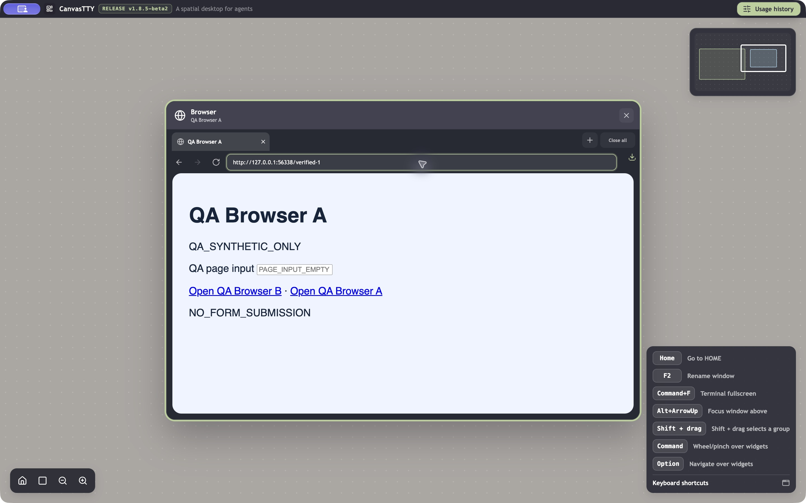

# fix(browser): retain address focus on first click

## Problem

After clicking empty canvas, the first click in the Browser address field transfers keyboard focus to the native page. Input can reach a page form instead of navigation. A second address click works.

## Environment

Original failure: official CanvasTTY **1.8.5-beta2**, macOS 27.0 (26A428), arm64, isolated QA profile through `CANVASTTY_USER_DATA_DIR`, synthetic test data. Base: `df274cfb144b2d46bbc3ab6a3b2d92c12549169e`; original app.asar SHA256: `fef3047003ca7987e7062f23d700e6edf30fce75adee9476b27437815a2fd184`.

Browser checks used UI scale 1. The input check used a Russian keyboard layout and a panned canvas at non-default zoom; the exact zoom was not recorded.

## Original problem: reproduction and evidence

1. Open Browser with a loaded test page.
2. Click empty canvas.
3. Click Address or search query once and inspect focus or paste a synthetic URL.
4. Click the same field again without leaving the widget.

**Expected:** the first click retains address-field focus; Enter submits the navigation form.
**Observed:** the first click focuses native Example Domain content; the second focuses the address field. A preliminary observation sent a synthetic URL to the page search form.

**Repeatability:** 3/3 controlled first/second-click pairs. Selected lines from the first pair:

```text
The focused UI element is 113 HTML content Example Domain, URL: example.com/
The focused UI element is 55 text field (settable) Description: Address or search query, Value: https://example.com/
```

Two additional recorded pairs show the same result:

```json
[
  {
    "trial": 1,
    "first": "The focused UI element is 113 HTML content Example Domain, URL: example.com/",
    "second": "The focused UI element is 55 text field (settable) Description: Address or search query, Value: https://example.com/"
  },
  {
    "trial": 2,
    "first": "The focused UI element is 113 HTML content Example Domain, URL: example.com/",
    "second": "The focused UI element is 55 text field (settable) Description: Address or search query, Value: https://example.com/"
  }
]
```

The AX records establish reported keyboard focus at these samples. They do not visually show cursor/caret movement or delivered keystrokes. No sequence video is available. A normal-looking address-field screenshot adds no evidence of this ownership change and is omitted.

## Cause and implemented change

Card activation schedules browser.focus() on the next animation frame. Without checking addressFocused, that callback can hand focus from the input to webContents. The second click does not cause the same focused-state transition. Source and controlled component tests support this chain; a separate live callback trace was not captured.

The callback now checks the current addressFocused ref immediately before native focus. This also handles input focus arriving after the frame was scheduled, while preserving ordinary page activation and cleanup when hidden.

Baseline source: [deferred focus](https://github.com/howdeploy/CanvasTTY/blob/df274cfb144b2d46bbc3ab6a3b2d92c12549169e/src/renderer/src/features/browser/BrowserCard.tsx#L236), [native focus](https://github.com/howdeploy/CanvasTTY/blob/df274cfb144b2d46bbc3ab6a3b2d92c12549169e/src/main/services/BrowserService.ts#L384).

Branch: `fix/beta2-browser-address-focus`. Fixed revision: `2b60ecfbbb2a05e1d34cd6aa8e3f9706c4293c56`; direct parent: exact beta2 `df274cfb144b2d46bbc3ab6a3b2d92c12549169e`.

## Result after the fix: evidence

**Component/effect boundary:** both address-focus regressions failed on beta2 and pass with the fix. Production BrowserCard runs against the existing fake-React harness with a controlled animation frame. Tests observe no native-focus call when the address field owns focus, and retain a positive ordinary-page activation control.

Focused GREEN log excerpt:

```text
✔ the first address click after canvas focus does not hand focus to the native page (21.651542ms)
✔ address focus arriving before the pending animation frame cancels native focus (8.146625ms)
✔ activating Browser outside the address still focuses its page, while hiding cancels it (7.006292ms)
ℹ tests 11
ℹ pass 11
ℹ fail 0
ℹ skipped 0
```

Node and renderer typechecks passed in the recorded checks.

### Packaged GUI result — passed for first-click delivery and navigation

**3/3 controlled trials passed:** click empty canvas → click the address once → select/paste a unique local URL → Enter. Two used the initial automatic Browser camera and one followed a single Zoom out action. In each trial AX reported address-field focus after the first click; the unique URL appeared in that field, the page input stayed empty, and Enter loaded QA Navigation Verified at the intended URL.

Selected after-change records:

```json
[
  {
    "camera": "automatic-camera-1",
    "url": "http://127.0.0.1:56338/verified-1",
    "afterOneClick": [
      "The focused UI element is 37 text field (settable) Description: Address or search query, Value: http://127.0.0.1:56338/a"
    ],
    "afterPaste": "\t\t\t\t\t\t\t\t37 text field (settable) Description: Address or search query, Value: http://127.0.0.1:56338/verified-1\n\t\t\t\t\t66 text QA page input \n\t\t\t\t\t67 text field (settable) Description: QA page input, Placeholder: PAGE_INPUT_EMPTY\nThe focused UI element is 37 text field (settable) Description: Address or search query, Value: http://127.0.0.1:56338/verified-1",
    "afterEnter": "\t\t\t\t\t\t\t26 text QA Navigation Verified\n\t\t\t\t\t\t\t\t29 tab (selected) QA Navigation Verified, Value: 1\n\t\t\t\t\t\t\t\t37 text field (settable) Description: Address or search query, Value: http://127.0.0.1:56338/verified-1\n\t\t\t61 HTML content QA Navigation Verified, URL: 127.0.0.1:56338/verified-1\n\t\t\t\t62 heading QA Navigation Verified, Value: 1\n\t\t\t\t\t63 text QA Navigation Verified\n\t\t\t\t\t66 text QA page input \n\t\t\t\t\t67 text field (settable) Description: QA page input, Placeholder: PAGE_INPUT_EMPTY\nThe focused UI element is 61 HTML content QA Navigation Verified, URL: 127.0.0.1:56338/verified-1"
  },
  {
    "camera": "automatic-camera-2",
    "url": "http://127.0.0.1:56338/verified-2",
    "afterOneClick": [
      "The focused UI element is 37 text field (settable) Description: Address or search query, Value: http://127.0.0.1:56338/verified-1"
    ],
    "afterPaste": "\t\t\t\t\t\t\t\t37 text field (settable) Description: Address or search query, Value: http://127.0.0.1:56338/verified-2\n\t\t\t\t\t66 text QA page input \n\t\t\t\t\t67 text field (settable) Description: QA page input, Placeholder: PAGE_INPUT_EMPTY\nThe focused UI element is 37 text field (settable) Description: Address or search query, Value: http://127.0.0.1:56338/verified-2",
    "afterEnter": "\t\t\t\t\t\t\t26 text QA Navigation Verified\n\t\t\t\t\t\t\t\t29 tab (selected) QA Navigation Verified, Value: 1\n\t\t\t\t\t\t\t\t37 text field (settable) Description: Address or search query, Value: http://127.0.0.1:56338/verified-2\n\t\t\t61 HTML content QA Navigation Verified, URL: 127.0.0.1:56338/verified-2\n\t\t\t\t62 heading QA Navigation Verified, Value: 1\n\t\t\t\t\t63 text QA Navigation Verified\n\t\t\t\t\t66 text QA page input \n\t\t\t\t\t67 text field (settable) Description: QA page input, Placeholder: PAGE_INPUT_EMPTY\nThe focused UI element is 61 HTML content QA Navigation Verified, URL: 127.0.0.1:56338/verified-2"
  },
  {
    "camera": "zoom-out-1",
    "url": "http://127.0.0.1:56338/verified-3",
    "afterOneClick": [
      "The focused UI element is 37 text field (settable) Description: Address or search query, Value: http://127.0.0.1:56338/verified-2"
    ],
    "afterPaste": "\t\t\t\t\t\t\t\t37 text field (settable) Description: Address or search query, Value: http://127.0.0.1:56338/verified-3\n\t\t\t\t\t66 text QA page input \n\t\t\t\t\t67 text field (settable) Description: QA page input, Placeholder: PAGE_INPUT_EMPTY\nThe focused UI element is 37 text field (settable) Description: Address or search query, Value: http://127.0.0.1:56338/verified-3",
    "afterEnter": "\t\t\t\t\t\t\t26 text QA Navigation Verified\n\t\t\t\t\t\t\t\t29 tab (selected) QA Navigation Verified, Value: 1\n\t\t\t\t\t\t\t\t37 text field (settable) Description: Address or search query, Value: http://127.0.0.1:56338/verified-3\n\t\t\t61 HTML content QA Navigation Verified, URL: 127.0.0.1:56338/verified-3\n\t\t\t\t62 heading QA Navigation Verified, Value: 1\n\t\t\t\t\t63 text QA Navigation Verified\n\t\t\t\t\t66 text QA page input \n\t\t\t\t\t67 text field (settable) Description: QA page input, Placeholder: PAGE_INPUT_EMPTY\nThe focused UI element is 61 HTML content QA Navigation Verified, URL: 127.0.0.1:56338/verified-3"
  }
]
```



The image establishes the sampled text placement. The ordered AX records and resulting URL establish the tested ownership/navigation sequence; the still image alone does not show the first click. No continuous video was captured.

A positive page-input control accepted `QA_PAGE_CONTROL`. A separate physical-key control produced `й` from the q key under the active Russian layout in the page and, after another canvas → one address click, in the address field. This confirms ordinary page activation still works and keyboard input can reach the address.

**Automation limit:** `typeText('QA_TYPED_42')` produced `__42` in both independent fields despite correct focus. Its literal typed-URL control was not accepted as passed; paste-based navigation and individual-key delivery are the verified input paths. The exact numerical zoom of the original baseline was never recorded, so this does not claim an identical historical zoom. GUI cancellation during the precise scheduled-frame race is not forced here; the component regression covers it.

**GUI build identity:** independent QA copy at fixed revision `2b60ecfbbb2a05e1d34cd6aa8e3f9706c4293c56`, ASAR SHA256 `b2e403ce4015b1bb5f08e8f578518847a521d89848fa2a3ce58b23cb5f9eee17`. The official beta2 Electron 43.8.1/native dependencies were retained; this branch’s production main/preload/renderer were compiled, copied and byte-verified in the package. Local ad-hoc signing used the updated ASAR integrity hash, with integrity enforcement enabled. Separate QA profile; no dev server or product-source changes. This does not claim the complete release packaging pipeline was run.


Workaround on beta2: click the address field twice after leaving Browser for empty canvas.

## Verification limits

The selected test logs are reused from the stated unchanged commit; no new execution is claimed. The full suite has not been established green. There was no comparative Linux/Windows or earlier-release GUI run, so platform exclusivity and regression status are not claimed. Selected screenshots are versioned alongside this report; their captions distinguish the original problem from the fixed result.

The implementation and tests were verified at the fixed revision above. The subsequent documentation-only commit adds this report and selected evidence; it does not change executable code. Each fix is independent and targets `dev/1.8.5-beta2-optimization`, whose head was verified as exact beta2 before publication.
