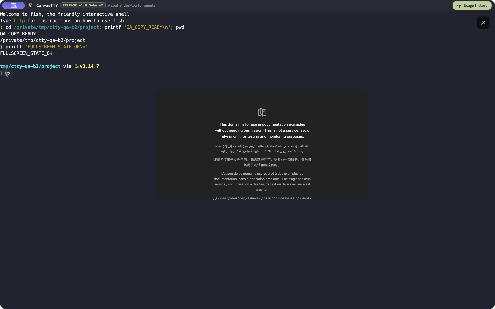
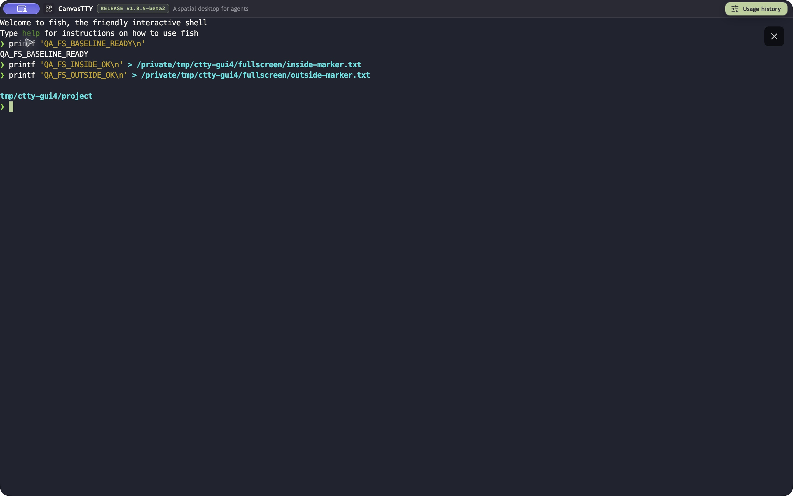
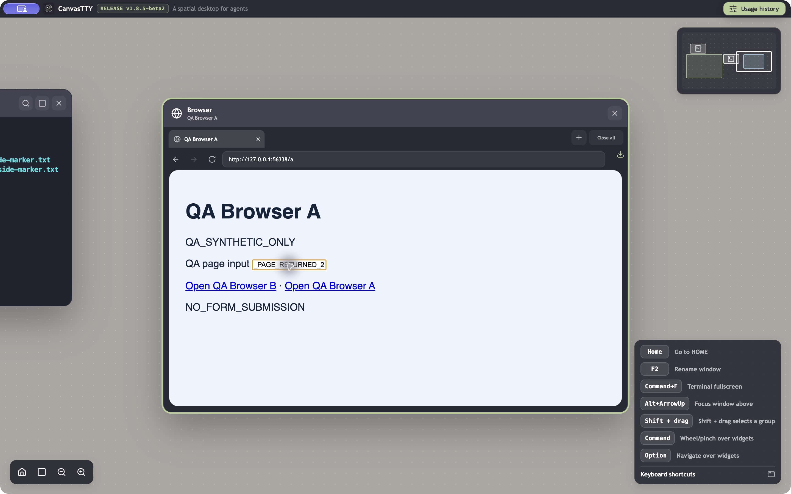
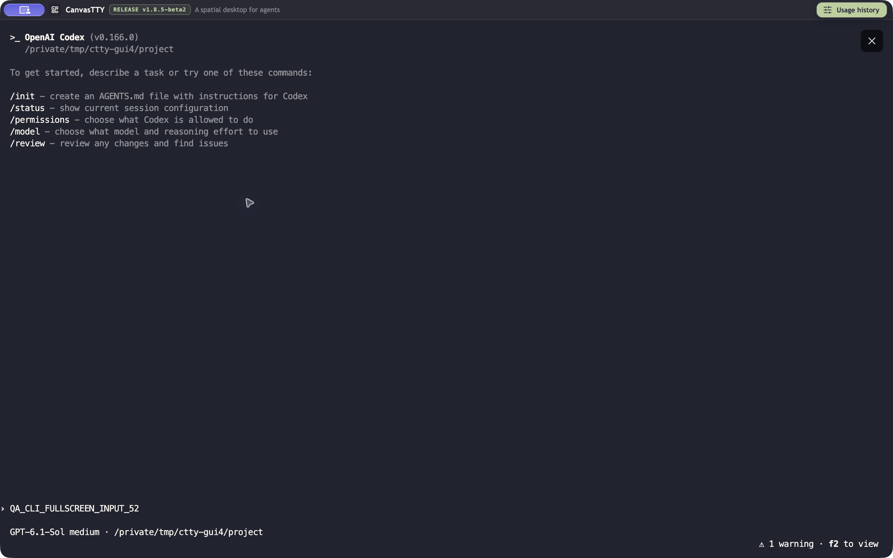

# fix(browser): hide native page during terminal fullscreen

## Problem

A live native Browser page stays above a fullscreen terminal, obscuring output and intercepting clicks inside its rectangle.

## Environment

Original failure: official CanvasTTY **1.8.5-beta2**, macOS 27.0 (26A428), arm64, isolated QA profile through `CANVASTTY_USER_DATA_DIR`, synthetic test data. Base: `df274cfb144b2d46bbc3ab6a3b2d92c12549169e`; original app.asar SHA256: `fef3047003ca7987e7062f23d700e6edf30fce75adee9476b27437815a2fd184`.

## Original problem: reproduction and evidence

1. Place a terminal and Browser with a loaded test page side by side.
2. Choose Enter fullscreen on the terminal.
3. Click the rectangle previously occupied by the web page.

**Expected:** terminal fullscreen hides the Browser surface and lets the terminal receive input throughout the workspace.
**Observed:** the page remains above the expanded terminal without Browser chrome. Clicking its rectangle focuses the page; clicking outside it can focus the terminal.

**Repeatability:** 2/2 transitions, with a live shell and an idle Codex CLI after a completed synthetic turn.



The image establishes the visible overlap at that moment. It does not show the transition or click ownership. The same baseline AX record separately contains the fullscreen exit action, native page and current focus:

```text
83 button Exit fullscreen
110 HTML content Example Domain, URL: example.com/
The focused UI element is 110 HTML content Example Domain, URL: example.com/
```

This excerpt establishes that recorded ownership state, not a continuous input sequence. No transition video was captured.

## Cause and implemented change

The BrowserCard visibility gate did not exclude terminal fullscreen, so the native viewport was not told to hide. WorkspaceCanvas now excludes any non-null fullscreenSessionId from Browser visibility. The card and terminal host stay mounted, and existing visibility blockers remain effective on exit.

Baseline source: [WorkspaceCanvas](https://github.com/howdeploy/CanvasTTY/blob/df274cfb144b2d46bbc3ab6a3b2d92c12549169e/src/renderer/src/features/workspace/WorkspaceCanvas.tsx#L1350).

Branch: `fix/beta2-browser-fullscreen`. Fixed revision: `81c72c3b3a668912c0d15df22db05f00b68ae8d1`; direct parent: exact beta2 `df274cfb144b2d46bbc3ab6a3b2d92c12549169e`.

## Result after the fix: evidence

**Production visibility-expression boundary:** regressions failed on beta2 and pass after the change. Entering or switching terminal fullscreen hides Browser; exiting returns to its previous visibility subject to other blockers. Related checks cover viewport geometry and persistent terminal hosting.

Focused GREEN log excerpt:

```text
✔ native Browser visibility follows terminal fullscreen enter, switch and exit (0.590167ms)
✔ exiting fullscreen still respects every existing Browser visibility blocker (0.083584ms)
ℹ tests 19
ℹ pass 19
ℹ fail 0
ℹ skipped 0
```

Node and renderer typechecks passed in the recorded checks.

### Packaged GUI result — passed for shell and idle CLI transitions

Two distinct local fish shells each entered/exited fullscreen with a live QA Browser A page visible before entry: **2/2 transitions passed**. In fullscreen, the page was absent from the captured pixels. Clicks inside the former Browser rectangle and outside it both delivered commands to the first shell; a separate command executed in the second fullscreen shell. The commands created these synthetic files:

```text
inside-marker.txt:  QA_FS_INSIDE_OK
outside-marker.txt: QA_FS_OUTSIDE_OK
second-marker.txt:  QA_FS_SECOND_OK
```



The image establishes the non-overlapping visible state. The shell-created files independently establish command delivery following the sampled clicks. Hidden Browser content remained in the AX tree, so AX presence/absence was not used to infer native visibility. Focus samples reported Terminal input.

On each exit, the same Browser URL returned and the page input accepted `QA_PAGE_RETURNED_1`, then `QA_PAGE_RETURNED_2`:

```text
42 text field (settable) Description: Address or search query, Value: http://127.0.0.1:56338/a
								47 button Enter fullscreen
								56 button Enter fullscreen
					87 text QA page input
					88 text field (settable) Description: QA page input, Value: QA_PAGE_RETURNED_2, Placeholder: PAGE_INPUT_EMPTY
The focused UI element is 88 text field (settable) Description: QA page input, Value: QA_PAGE_RETURNED_2, Placeholder: PAGE_INPUT_EMPTY
```



A third transition also passed with the installed idle **Codex CLI v0.166.0** in Manual mode. With the live Browser page visible before entry, fullscreen hid it; clicking the former page area and pasting `QA_CLI_FULLSCREEN_INPUT_52` placed that marker in the CLI prompt. The marker was not submitted. After exiting, the same page URL returned and its input accepted `QA_CLI_PAGE_RETURNED`. No AI request was sent and no authentication or permissions dialogs were accepted.



The total GUI result is **3/3 transitions: two local shells and one idle CLI**. These are sampled screenshots, AX states and terminal outputs, not a continuous transition video. Forced switching directly from one fullscreen session to another remains test-boundary evidence; these GUI trials exited between sessions.

**GUI build identity:** independent QA copy at fixed revision `81c72c3b3a668912c0d15df22db05f00b68ae8d1`, ASAR SHA256 `d99a9b89c42d0cfee7f4d686c989941a1400e58df72086025998d2cf105dc44a`. The official beta2 Electron 43.8.1/native dependencies were retained; this branch’s production main/preload/renderer were compiled, copied and byte-verified in the package. Local ad-hoc signing used the updated ASAR integrity hash, with integrity enforcement enabled. Separate QA profile; no dev server or product-source changes. This does not claim the complete release packaging pipeline was run.


Workaround on beta2: hide Browser before entering terminal fullscreen.

## Verification limits

The selected test logs are reused from the stated unchanged commit; no new execution is claimed. The full suite has not been established green. There was no comparative Linux/Windows or earlier-release GUI run, so platform exclusivity and regression status are not claimed. Selected screenshots are versioned alongside this report; their captions distinguish the original problem from the fixed result.

The implementation and tests were verified at the fixed revision above. The subsequent documentation-only commit adds this report and selected evidence; it does not change executable code. Each fix is independent and targets `dev/1.8.5-beta2-optimization`, whose head was verified as exact beta2 before publication.
