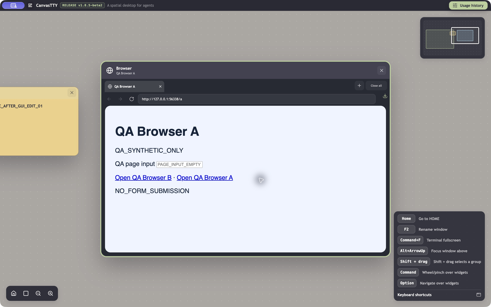

# fix(browser): preserve saved tabs before lazy restoration

## Problem

Saved Browser tab URLs and the active-tab ID can be erased after relaunch, before Browser is first opened. Editing a sticky note or quitting normally triggers the loss while Restore tabs is still enabled. Cookie loss or loss of the entire browser profile was not established.

## Environment

Original failure: official CanvasTTY **1.8.5-beta2**, macOS 27.0 (26A428), arm64, isolated QA profile through `CANVASTTY_USER_DATA_DIR`, synthetic test data. Base: `df274cfb144b2d46bbc3ab6a3b2d92c12549169e`; original app.asar SHA256: `fef3047003ca7987e7062f23d700e6edf30fce75adee9476b27437815a2fd184`.

## Original problem: reproduction and evidence

1. Enable Restore tabs, open a synthetic test page, hide Browser and quit normally.
2. Relaunch without opening Browser.
3. Edit a sticky note and wait for saving, then open Browser.
4. For the second trigger, repeat steps 1–2 and quit normally without opening Browser.

**Expected:** saved tabs survive unrelated note changes and normal quit when restoration is enabled.
**Observed:** the persisted tab list becomes empty and activeTabId becomes null. Browser then opens its default page.

**Repeatability:** one controlled run per trigger; initialized-runtime quit controls preserved the saved tab. These are two triggers of one defect.

The following excerpts retain stage, state and relevant settings from four baseline records. They establish the disk-state change; a screenshot of the resulting default page would not establish that sequence.

**browser-tabs-after-lazy-launch.json — original beta2:**

```json
{
  "stage": "relaunch, Browser not opened",
  "state": {
    "version": 1,
    "tabs": [
      {
        "id": "4bfb6945-3114-47ff-959a-5b71adaeeb86",
        "url": "http://127.0.0.1:56225/"
      }
    ],
    "activeTabId": "4bfb6945-3114-47ff-959a-5b71adaeeb86"
  }
}
```

**browser-tabs-after-unrelated-edit.json — original beta2:**

```json
{
  "stage": "after only sticky-note edit, Browser never opened",
  "browserRestoreTabs": true,
  "state": {
    "version": 1,
    "tabs": [],
    "activeTabId": null
  }
}
```

**browser-tabs-lazy-quit-before.json — original beta2:**

```json
{
  "stage": "Browser never opened after relaunch, before quit",
  "state": {
    "version": 1,
    "tabs": [
      {
        "id": "6f820212-1fea-4c0f-8854-df6785e96a4f",
        "url": "http://127.0.0.1:56225/"
      }
    ],
    "activeTabId": "6f820212-1fea-4c0f-8854-df6785e96a4f"
  }
}
```

**browser-tabs-lazy-quit-after.json — original beta2:**

```json
{
  "stage": "after normal quit without opening Browser",
  "state": {
    "version": 1,
    "tabs": [],
    "activeTabId": null
  }
}
```

## Cause and implemented change

BrowserService loads saved tabs before creating its lazy runtime. An unrelated settings patch reapplies setRestoreTabs(true); normal quit uses dispose(). Both can persist the still-empty runtime map over the loaded state. The fix tracks runtime initialization and prevents that overwrite, while retaining intentional deletion after initialization and explicit disabling of restoration.

Exact baseline source: [initialization](https://github.com/howdeploy/CanvasTTY/blob/df274cfb144b2d46bbc3ab6a3b2d92c12549169e/src/main/services/BrowserService.ts#L582), [restore setting](https://github.com/howdeploy/CanvasTTY/blob/df274cfb144b2d46bbc3ab6a3b2d92c12549169e/src/main/services/BrowserService.ts#L413), [persistence](https://github.com/howdeploy/CanvasTTY/blob/df274cfb144b2d46bbc3ab6a3b2d92c12549169e/src/main/services/BrowserService.ts#L1270).

Branch: `fix/beta2-browser-tab-restore`. Fixed revision: `949ed40441f3e95ba026af7e394d3439f01a5d74`; direct parent: exact beta2 `df274cfb144b2d46bbc3ab6a3b2d92c12549169e`.

## Result after the fix: evidence

**Service/storage boundary:** both lazy-persistence regressions were recorded failing on beta2 and passing after the change. The tests execute production BrowserService and real disk storage, with fake Electron surfaces. The fixed code preserves saved tabs and active selection on settings reapplication and quit, while intentional last-tab closure and disabling restore still clear them.

Focused GREEN log excerpt from the fixed revision:

```text
✔ reapplying enabled restore before opening Browser preserves saved tabs and active selection (35.673917ms)
✔ quitting before opening Browser preserves saved tabs and active selection (15.160083ms)
✔ explicitly closing the last restored tab persists an empty tab list (48.657333ms)
✔ disabling restore before opening Browser explicitly clears saved tabs (12.138083ms)
ℹ tests 14
ℹ pass 14
ℹ fail 0
ℹ skipped 0
```

Node and renderer typechecks passed in the recorded checks.

### Packaged GUI result — passed for the tested scenarios

Using the same isolated profile across normal app restarts:

| Scenario | Actual GUI/storage result |
| --- | --- |
| Relaunch → edit the note before opening Browser | 1/1: edited note saved; the same tab URL and activeTabId survived; Browser then displayed QA Browser A |
| Relaunch → quit without opening Browser | 1/1: identical saved tab/active ID; QA Browser A restored on the next launch |
| Quit after runtime initialization | Saved tab and active ID preserved |
| Intentionally close the last tab | Empty tab list and null active ID persisted |
| Disable Restore tabs in Settings before first Browser opening | Restore became false and the saved tab set was cleared |

Selected after-change disk-state records (same fixed revision and profile; unrelated settings omitted):

```json
{
  "noteEdit": {
    "before": {
      "version": 1,
      "tabs": [
        {
          "id": "198f71eb-c286-4a89-ae1a-ac428ceb5e0e",
          "url": "http://127.0.0.1:56338/a"
        }
      ],
      "activeTabId": "198f71eb-c286-4a89-ae1a-ac428ceb5e0e"
    },
    "after": {
      "version": 1,
      "tabs": [
        {
          "id": "198f71eb-c286-4a89-ae1a-ac428ceb5e0e",
          "url": "http://127.0.0.1:56338/a"
        }
      ],
      "activeTabId": "198f71eb-c286-4a89-ae1a-ac428ceb5e0e"
    },
    "savedNote": "QA_NOTE_AFTER_GUI_EDIT_01",
    "restoreEnabled": true
  },
  "quitBeforeBrowser": {
    "before": {
      "version": 1,
      "tabs": [
        {
          "id": "198f71eb-c286-4a89-ae1a-ac428ceb5e0e",
          "url": "http://127.0.0.1:56338/a"
        }
      ],
      "activeTabId": "198f71eb-c286-4a89-ae1a-ac428ceb5e0e"
    },
    "after": {
      "version": 1,
      "tabs": [
        {
          "id": "198f71eb-c286-4a89-ae1a-ac428ceb5e0e",
          "url": "http://127.0.0.1:56338/a"
        }
      ],
      "activeTabId": "198f71eb-c286-4a89-ae1a-ac428ceb5e0e"
    }
  }
}
```



The screenshot establishes the displayed restored page/note, while the JSON sequence establishes persistence across the actions. The screenshot alone is not proof of the preceding restart or write sequence. Original beta2 records above and these fixed records use different synthetic URLs/profiles but exercise the same two triggers.

**GUI build identity:** independent QA copy at fixed revision `949ed40441f3e95ba026af7e394d3439f01a5d74`, ASAR SHA256 `36747d18d24a9993104ba398ef6538f84987e29e056df3b80fda000359270e90`. The official beta2 Electron 43.8.1/native dependencies were retained; this branch’s production main/preload/renderer were compiled, copied and byte-verified in the package. Local ad-hoc signing used the updated ASAR integrity hash, with integrity enforcement enabled. Separate QA profile; no dev server or product-source changes. This does not claim the complete release packaging pipeline was run.


Workaround on beta2: open Browser once after each launch before changing notes/settings or quitting. This does not recover already-erased tabs.

## Verification limits

The selected test logs are reused from the stated unchanged commit; no new execution is claimed. The full suite has not been established green. There was no comparative Linux/Windows or earlier-release GUI run, so platform exclusivity and regression status are not claimed. Selected screenshots are versioned alongside this report; their captions distinguish the original problem from the fixed result.

The implementation and tests were verified at the fixed revision above. The subsequent documentation-only commit adds this report and selected evidence; it does not change executable code. Each fix is independent and targets `dev/1.8.5-beta2-optimization`, whose head was verified as exact beta2 before publication.
